<div align="center">

# COOPERSAL

### Sistema de Gestão Operacional para Cooperativa de Reciclagem

Aplicação web full stack que digitaliza a operação de uma cooperativa de reciclagem: coletas, rotas, frota, abastecimentos, produção de materiais e indicadores operacionais.


</div>

<p align="center">
  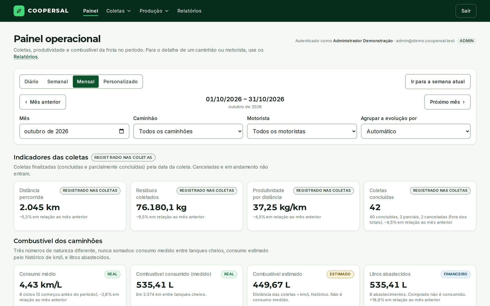
  <br><sub>Painel operacional. Todas as imagens usam dados fictícios de demonstração.</sub>
</p>

## Destaques técnicos

- **Full stack de ponta a ponta:** API NestJS com 11 módulos de domínio e frontend Next.js com camada BFF, cada um com CI e implantação próprios.
- **Regras garantidas no banco:** índices únicos parciais, `CHECK`s e triggers no PostgreSQL impedem escalas duplicadas e alterações na origem das coletas, mesmo sob concorrência.
- **Concorrência testada:** locks de linha em ordem fixa, verificados por testes determinísticos contra um PostgreSQL real.
- **Indicadores confiáveis:** consumo de combustível por ciclos entre tanques cheios, em aritmética inteira, sinalizando dados incompletos em vez de exibir números enganosos.
- **Sessão segura e distribuída:** cookies `HttpOnly`, rotação atômica de refresh token e lock de renovação em Redis.
- **Qualidade verificável:** 1.645 testes unitários executados localmente e suítes E2E (Supertest e Playwright) aprovadas no CI.

## Sumário

[Minha contribuição](#minha-contribuição) · [Problema e solução](#o-problema-e-a-solução) · [Demonstração](#demonstração-visual) · [Funcionalidades](#funcionalidades) · [Tecnologias](#tecnologias) · [Arquitetura](#arquitetura) · [Desafios técnicos](#desafios-técnicos-e-soluções) · [Testes](#testes-e-qualidade) · [Evolução](#evolução-do-projeto) · [Código](#acesso-ao-código) · [Autor](#autor)

---

## Minha contribuição

Fui o **desenvolvedor full stack responsável pelo projeto**, do levantamento das necessidades à implantação.

| Competência         | Onde está evidenciada                                                                                                 |
| ------------------- | --------------------------------------------------------------------------------------------------------------------- |
| Backend e APIs REST | 11 módulos NestJS com casos de uso, DTOs validados, Swagger, paginação e erros padronizados                           |
| Modelagem de dados  | Schema Prisma com 13 modelos e 19 migrations, incluindo SQL próprio para índices parciais, `CHECK`s e triggers        |
| Regras de negócio   | Recorrência de rotas, ciclo de vida das coletas, consumo de combustível e consolidação da produção                    |
| Frontend            | Next.js App Router com Server Components, BFF e organização por funcionalidade                                        |
| Segurança           | Autenticação por cookies `HttpOnly`, RBAC, rate limit, rotação de refresh token e defesa contra CSRF no BFF           |
| Testes              | Testes unitários e E2E nas duas aplicações, incluindo testes determinísticos de concorrência                          |
| DevOps              | Pipelines no GitHub Actions, implantação na Vercel e no Render, e migração de dados para o Neon com plano de rollback |

**Métricas de autoria** (contagem do histórico Git em todas as branches):

| Repositório                | Commits de minha autoria | Pull requests integrados |
| -------------------------- | ------------------------ | ------------------------ |
| API (`api-coopersal`)      | 103 de 103               | 33                       |
| Frontend (`web-coopersal`) | 112 de 114               | 15                       |

---

## O problema e a solução

A cooperativa controlava coletas, escalas, abastecimentos e produção em planilhas e anotações dispersas. Isso dificultava planejar a semana, evitar escalas conflitantes, conferir o consumo da frota e comparar resultados entre períodos. O COOPERSAL reúne essas informações em uma única aplicação, com as regras de negócio aplicadas no servidor e no banco de dados.

<details>
<summary><b>Como cada necessidade é atendida</b></summary>

| Necessidade                              | Como o sistema atende                                                                                                                          |
| ---------------------------------------- | ---------------------------------------------------------------------------------------------------------------------------------------------- |
| Centralizar informações                  | Cadastros únicos de bairros, rotas, motoristas, caminhões e materiais, com exclusão lógica para preservar o histórico                          |
| Organizar as coletas                     | Rotas recorrentes ou avulsas geram as coletas, que seguem o ciclo _programada → em andamento → concluída / parcialmente concluída / cancelada_ |
| Controlar a frota                        | Motorista e caminhão são confirmados na saída; o banco impede que estejam em duas coletas em andamento ao mesmo tempo                          |
| Registrar abastecimentos e quilometragem | Litros, preço, hodômetro e tanque cheio; distância por hodômetro ou informada manualmente                                                      |
| Acompanhar a produção                    | Lançamentos diários por material, com preço aplicado preservado em cada lançamento                                                             |
| Apoiar decisões                          | Painel e relatórios comparados com o período anterior, separando dados **reais**, **estimados** e **financeiros**                              |

</details>

---

## Demonstração visual

> Capturas do sistema real, feitas em ambiente isolado com **dados fictícios**. CPF, CNH e telefone aparecem borrados, assim como os preços de referência dos materiais.

<table>
  <tr>
    <td width="50%" valign="top">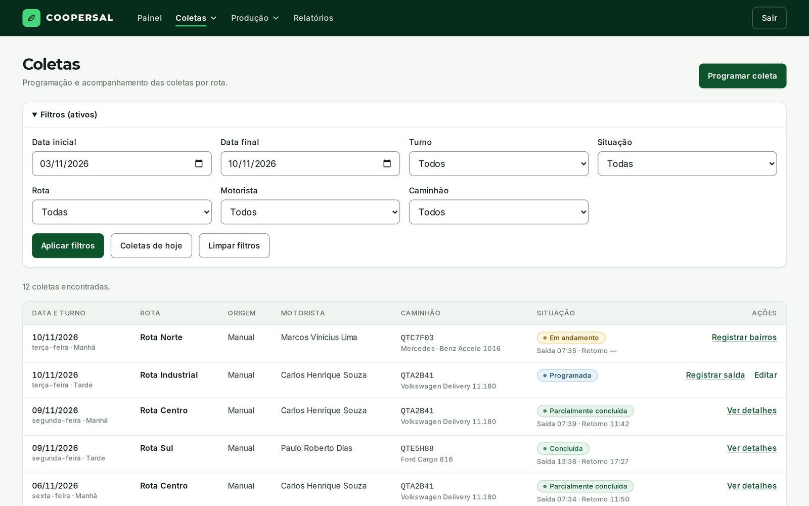</td>
    <td width="50%" valign="top">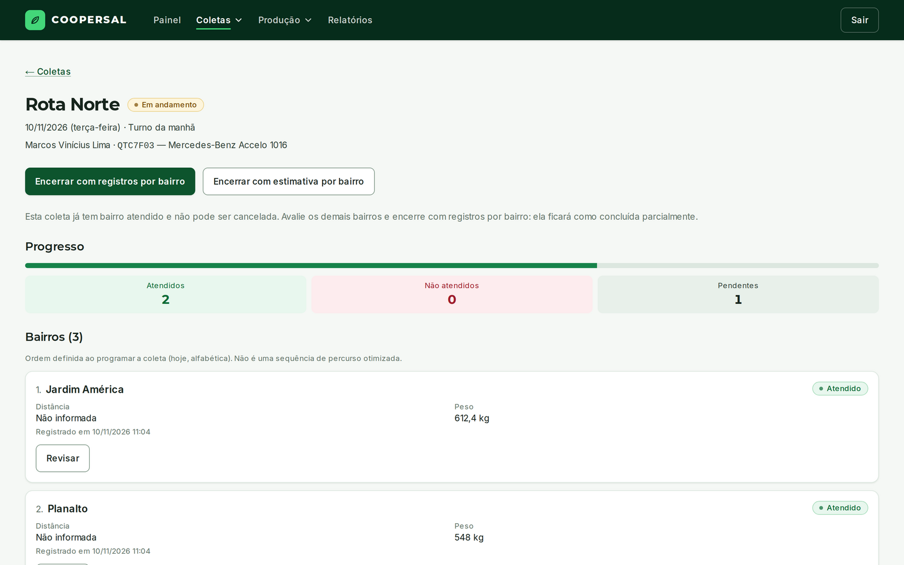</td>
  </tr>
  <tr>
    <td valign="top"><sub><b>Coletas</b>: filtros por período, turno, situação, rota, motorista e caminhão.</sub></td>
    <td valign="top"><sub><b>Execução</b>: atendimento bairro a bairro, com encerramento detalhado ou por estimativa.</sub></td>
  </tr>
  <tr>
    <td valign="top">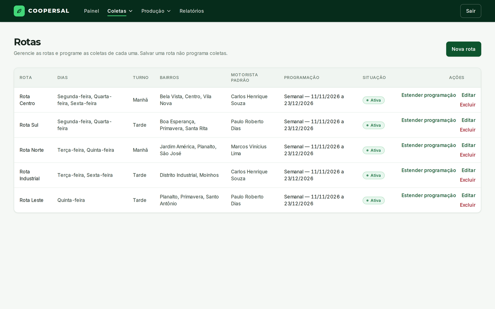</td>
    <td valign="top">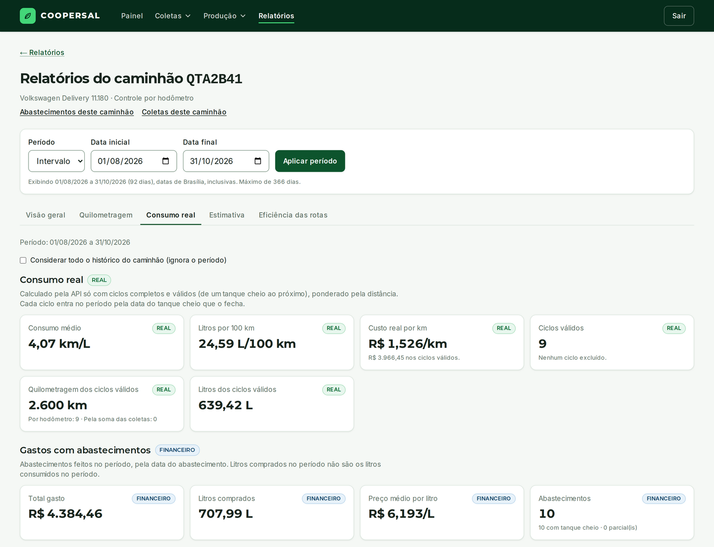</td>
  </tr>
  <tr>
    <td valign="top"><sub><b>Rotas</b>: dias, turno, bairros, motorista padrão e período programado.</sub></td>
    <td valign="top"><sub><b>Consumo real</b>: km/L e custo por km entre tanques cheios, separados dos gastos.</sub></td>
  </tr>
</table>

<details>
<summary><b>Ver todas as telas</b> (painel, coletas, frota e produção)</summary>

<br>

<p align="center">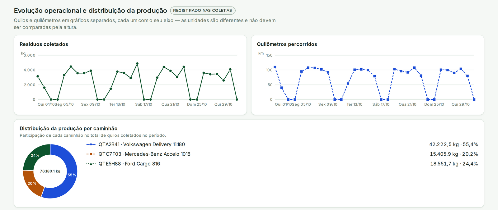<br>
<sub><b>Painel</b>: evolução de quilos e quilômetros em gráficos separados e distribuição da coleta por caminhão.</sub></p>

<table>
  <tr>
    <td width="50%" valign="top">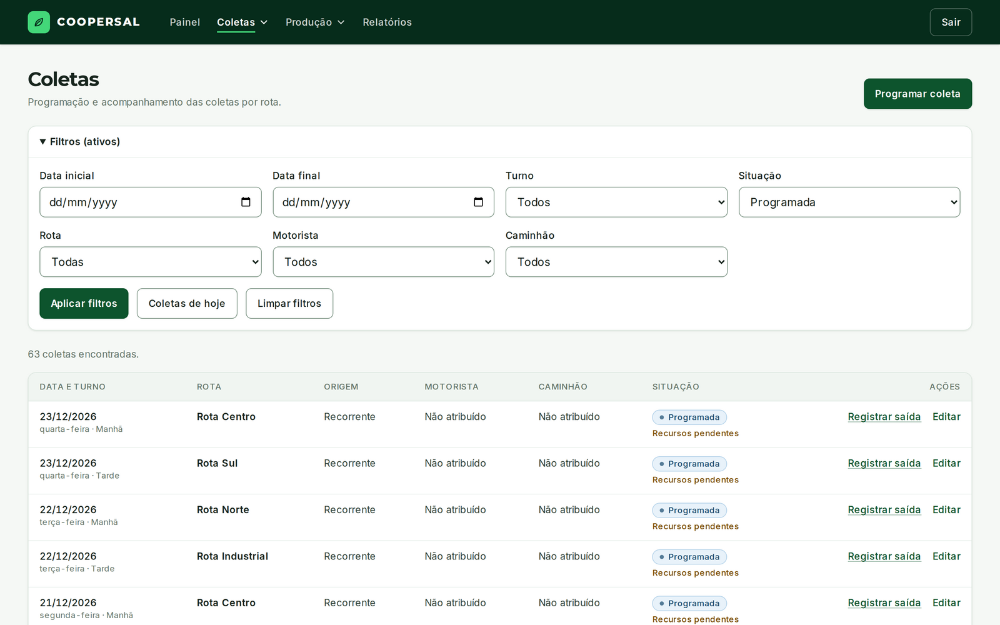</td>
    <td width="50%" valign="top">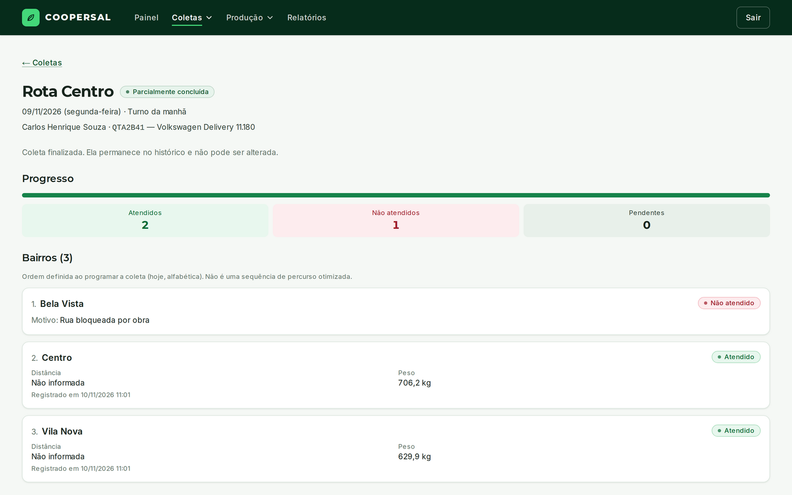</td>
  </tr>
  <tr>
    <td valign="top"><sub><b>Coletas recorrentes</b>: geradas sem recursos, que são definidos na saída.</sub></td>
    <td valign="top"><sub><b>Encerramento</b>: bairro não atendido com motivo; a coleta fica parcialmente concluída.</sub></td>
  </tr>
  <tr>
    <td valign="top">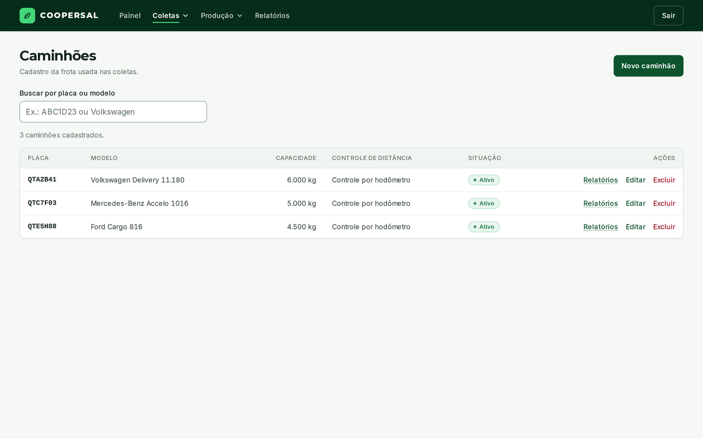</td>
    <td valign="top">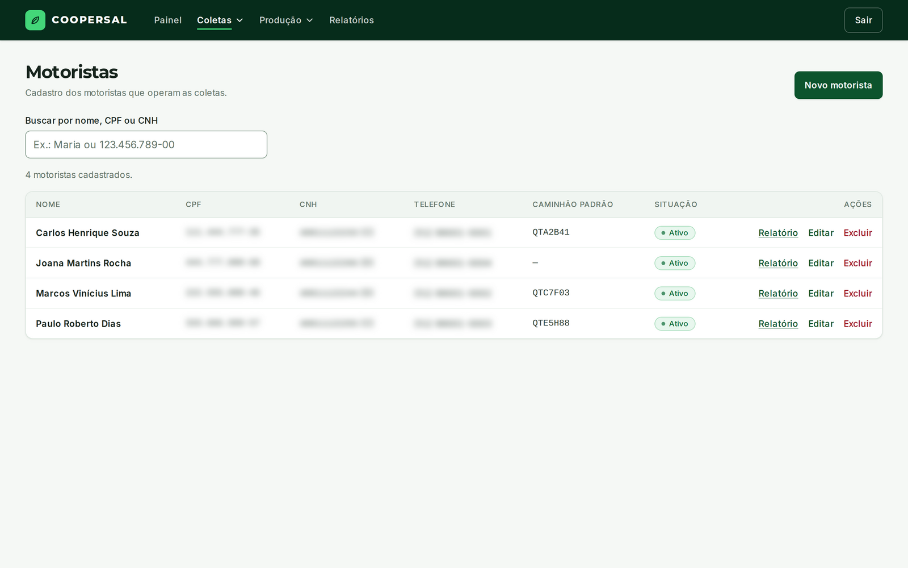</td>
  </tr>
  <tr>
    <td valign="top"><sub><b>Caminhões</b>: capacidade e controle de distância por hodômetro ou manual.</sub></td>
    <td valign="top"><sub><b>Motoristas</b>: documentos (borrados) e caminhão padrão; acesso restrito a administradores.</sub></td>
  </tr>
  <tr>
    <td valign="top">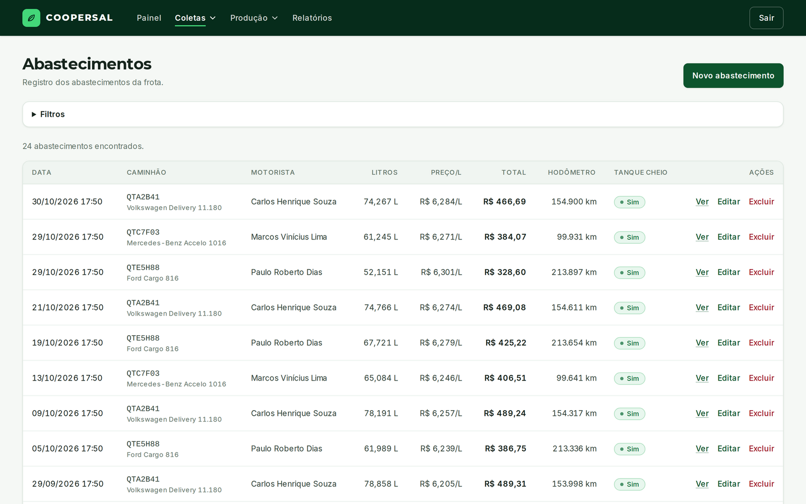</td>
    <td valign="top">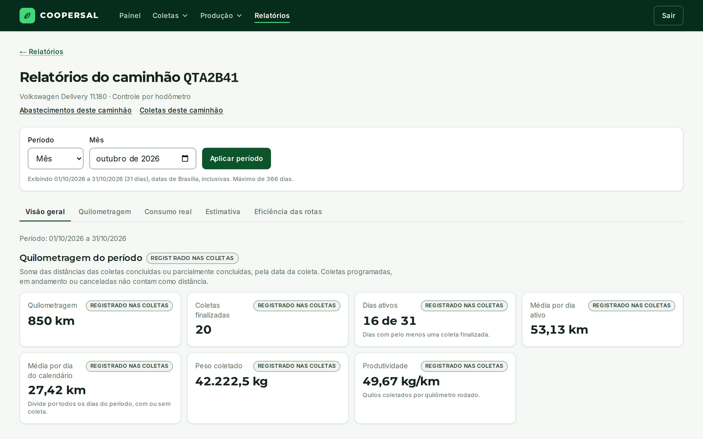</td>
  </tr>
  <tr>
    <td valign="top"><sub><b>Abastecimentos</b>: litros, preço, total, hodômetro e tanque cheio.</sub></td>
    <td valign="top"><sub><b>Relatório do caminhão</b>: quilometragem, consumo, estimativa e eficiência das rotas.</sub></td>
  </tr>
  <tr>
    <td valign="top">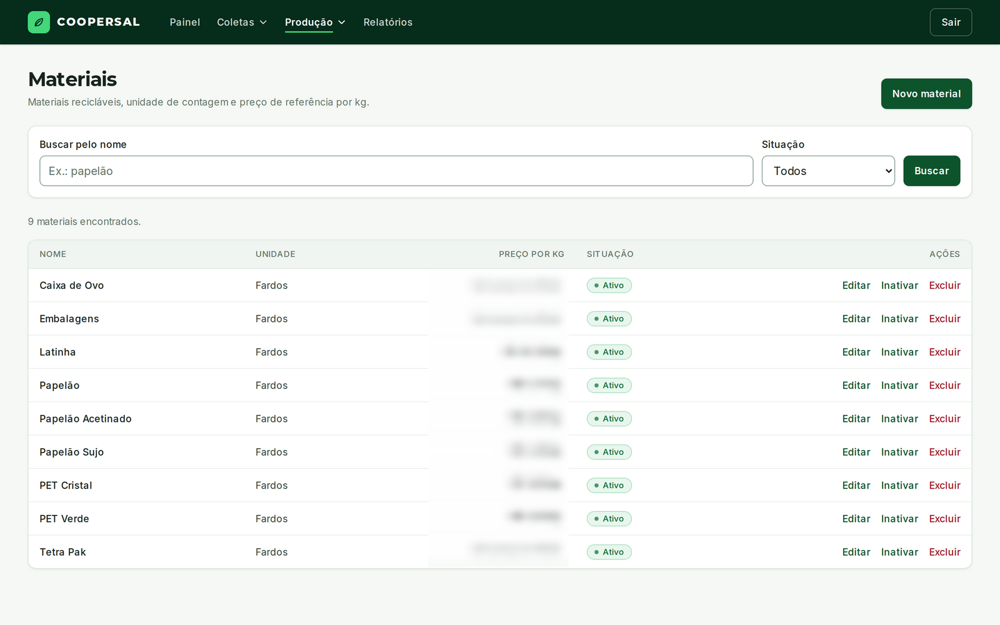</td>
    <td valign="top">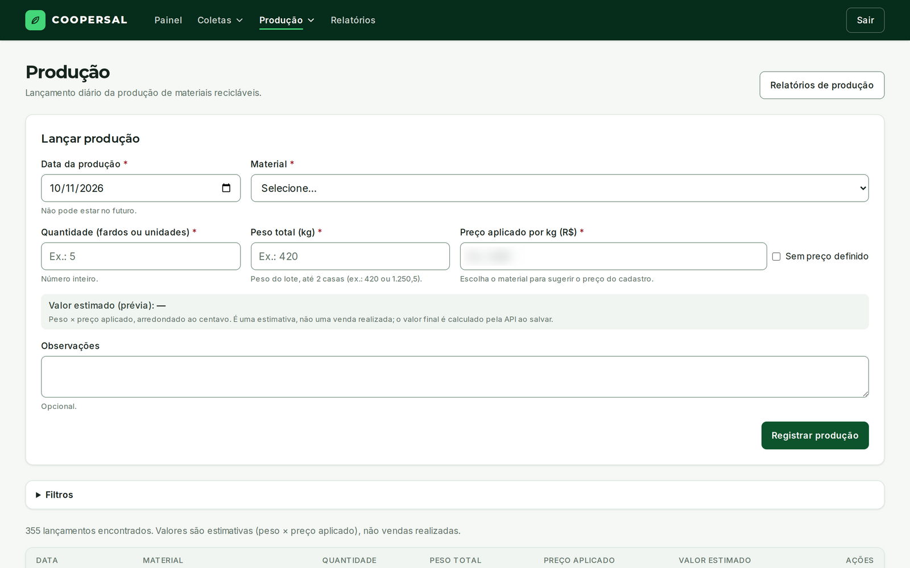</td>
  </tr>
  <tr>
    <td valign="top"><sub><b>Materiais</b>: unidade de contagem e preço de referência (ocultado).</sub></td>
    <td valign="top"><sub><b>Produção</b>: lançamento diário com quantidade, peso e valor estimado.</sub></td>
  </tr>
  <tr>
    <td colspan="2" valign="top">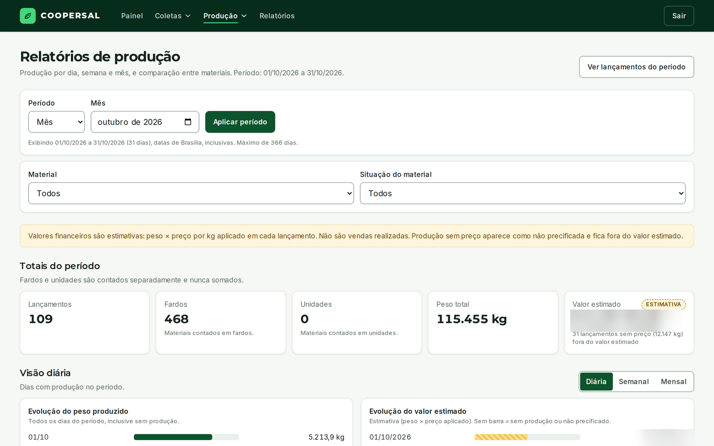</td>
  </tr>
  <tr>
    <td colspan="2" valign="top"><sub><b>Relatório de produção</b>: totais e visões diária, semanal e mensal; fardos e unidades nunca são somados (valores financeiros ocultados).</sub></td>
  </tr>
</table>

</details>

---

## Funcionalidades

| Domínio         | Principais recursos                                                                                                                                                       |
| --------------- | ------------------------------------------------------------------------------------------------------------------------------------------------------------------------- |
| **Coletas**     | Programação manual ou recorrente, ciclo de vida completo, saída com motorista e caminhão, atendimento por bairro, encerramento detalhado ou rápido, histórico com filtros |
| **Rotas**       | Programação avulsa ou semanal, extensão do período sem duplicar coletas, validação de conflitos                                                                           |
| **Frota**       | Motoristas, caminhões, abastecimentos auditados, quilometragem, consumo e produtividade (kg/km)                                                                           |
| **Produção**    | Materiais, lançamentos diários com preço aplicado preservado, consolidação por dia, semana e mês                                                                          |
| **Indicadores** | Painel comparado ao período anterior; relatórios por caminhão, motorista e produção                                                                                       |
| **Acesso**      | Perfis `ADMIN` e `USER`, rate limit no login e global                                                                                                                     |

**Em desenvolvimento:** agenda semanal e mensal de coletas. A interface já está na `main` do frontend, mas o endpoint de calendário da API ainda está em uma branch não integrada.

<details>
<summary><b>Detalhes das regras por domínio</b></summary>

#### Coletas

- Coletas **manuais** são programadas já com motorista (o caminhão pode vir do vínculo do motorista). Coletas **geradas pela recorrência** nascem sem recursos, porque a escala e a disponibilidade dos caminhões mudam; motorista e caminhão são definidos ao registrar a saída.
- A saída fica auditada: quem registrou e quando.
- O encerramento pode ser **detalhado**, com distância e peso por bairro, ou **rápido**, com a distância total dividida igualmente entre os bairros e marcada como estimada.
- O modo de registro da distância (hodômetro ou manual) é escolhido na saída e não muda depois.

#### Rotas

- Uma rota não pode ser programada se estiver inativa ou sem bairros. A mesma rota não pode ter duas coletas ativas na mesma data e turno.
- Estender a programação nunca recria uma ocorrência já gerada, mesmo que tenha sido cancelada ou remarcada.

#### Frota

- Placa, CPF e CNH são únicos entre os registros não excluídos (índices únicos parciais); após uma exclusão lógica, o valor pode ser reutilizado sem perder o histórico.
- Cada abastecimento registra uma revisão de auditoria (criação, edição e exclusão) na mesma transação.
- Relatórios por caminhão: quilometragem (diária, semanal e mensal), consumo real, estimativa pelo histórico, financeiro e eficiência das rotas (kg/km em relação ao histórico).

#### Produção

- Fardos e unidades nunca são somados entre si.
- O valor estimado é calculado como peso × preço aplicado, arredondado ao centavo em aritmética inteira e persistido. Produção sem preço fica fora do valor e é sinalizada, nunca tratada como zero.
- Semanas seguem a ISO 8601, e semanas ou meses cortados pelo período aparecem marcados como parciais.

</details>

---

## Tecnologias

| Camada         | Tecnologias                                                                            |
| -------------- | -------------------------------------------------------------------------------------- |
| Frontend       | Next.js 16 (App Router, BFF em Route Handlers), React 19, TypeScript 5, Tailwind CSS 4 |
| Backend        | Node.js 24, NestJS 11, Swagger, class-validator                                        |
| Dados          | PostgreSQL, Prisma ORM 7 (`@prisma/adapter-pg`), Neon; Redis para coordenar sessões    |
| Segurança      | JWT em cookies `HttpOnly`, bcrypt, Helmet, `@nestjs/throttler`                         |
| Qualidade      | Jest 30, Supertest, `node:test`, Playwright, ESLint 9, Prettier                        |
| Infraestrutura | Vercel (frontend), Render (API), Neon (banco), GitHub Actions (CI)                     |

---

## Arquitetura

- **Frontend e backend independentes:** o navegador nunca chama a API diretamente. Páginas (no servidor) e BFF fazem as chamadas e repassam os cookies `HttpOnly` definidos pela API, de modo que os tokens não ficam acessíveis ao JavaScript do cliente.
- **Camadas na API:** cada módulo tem `domain` (entidades, value objects, serviços puros e interfaces de repositório), `application` (um caso de uso por operação) e `infrastructure` (controllers, DTOs e repositórios Prisma), em uma organização inspirada em Clean Architecture.
- **Regras em três níveis:** serviços de domínio puros, casos de uso transacionais e restrições no próprio PostgreSQL.

<details>
<summary><b>Organização dos módulos, validação e tratamento de erros</b></summary>

```text
api-coopersal/src/modules/<domínio>/
├── domain/           entidades, enums, erros, value objects,
│                     serviços de domínio puros e interfaces de repositório
├── application/      casos de uso, cada um com testes unitários
└── infrastructure/   controllers, DTOs, mappers, repositórios Prisma
                      e repositórios em memória para os testes

web-coopersal/src/
├── app/              páginas (App Router) e Route Handlers do BFF
├── features/<domínio>/{components,services,types,utils}
└── lib/              cliente HTTP, sessão, datas no fuso operacional, formatação
```

- **Módulos da API:** autenticação, usuários, caminhões, motoristas, bairros, rotas, execuções de rota, abastecimentos, relatórios de frota, materiais e produção.
- **Testabilidade:** os casos de uso dependem de interfaces de repositório e são testados com implementações em memória; o SQL específico (locks, índices parciais) fica isolado na infraestrutura.
- **Validação:** `ValidationPipe` global com `whitelist` e `forbidNonWhitelisted` rejeita qualquer campo fora do contrato com `400`. As conversões da query string são explícitas e as variáveis de ambiente são validadas na inicialização.
- **Erros:** um filtro global padroniza as respostas. Violações de unicidade detectadas pelo banco, inclusive em requisições concorrentes, viram `409 Conflict` com mensagem específica. Cada requisição recebe um identificador (`x-request-id`) registrado em log e devolvido na resposta.
- **Frontend:** os erros são classificados (sessão inválida, serviço indisponível, validação), e uma falha de rede não encerra a sessão do usuário.
- **Fuso operacional:** datas civis são tratadas em `America/Sao_Paulo` nas duas aplicações.

</details>

---

## Desafios técnicos e soluções

**1. Recorrência de rotas sem coletas duplicadas.** A programação semanal precisa ser repetível sem recriar ocorrências canceladas ou remarcadas. Cada coleta recorrente guarda a data da ocorrência de origem, protegida por índice único parcial e trigger de imutabilidade, e a programação roda em uma única transação com a rota travada.

<details>
<summary>Problema → decisão → solução → benefício</summary>

- **Problema:** estender a programação não pode recriar coletas já geradas, mesmo canceladas, remarcadas para outro dia ou cobertas por uma coleta lançada manualmente.
- **Decisão:** cada coleta recorrente guarda a **data da ocorrência que a originou** (`recurrenceDate`). Ela não muda quando a coleta é remarcada e passa a ser a identidade da ocorrência.
- **Solução:**
  - um serviço de domínio puro classifica cada data candidata em _a criar_, _já gerada_, _coberta por coleta manual_ ou _coberta por outra ocorrência remarcada_;
  - a programação roda em uma única transação, com a rota travada (`FOR NO KEY UPDATE`), e grava tudo ou nada;
  - um índice único parcial em `(rota, recurrenceDate)` **inclui** coletas canceladas e excluídas, e um trigger torna a origem da coleta imutável; correções excepcionais passam por uma função auditada.
- **Idempotência:** a operação é idempotente por construção. Reexecutá-la para o mesmo período não cria nada novo e devolve as datas como _já geradas_. Ela não depende de cabeçalho; o mecanismo de `Idempotency-Key` é usado no cadastro de abastecimentos (desafio 3).
- **Benefício:** estender a programação é seguro e repetível, sem risco de duplicar coletas ou ressuscitar uma coleta cancelada.

</details>

**2. Integridade entre motoristas, caminhões e coletas sob concorrência.** Dois operadores podem usar o mesmo caminhão ao mesmo tempo. A regra é validada no código, para dar mensagens claras, e garantida no banco com índices parciais e locks de linha em ordem fixa.

<details>
<summary>Problema → decisão → solução → benefício</summary>

- **Problema:** a cooperativa alterna motoristas e caminhões (escalas e manutenção). Saídas simultâneas com o mesmo recurso, ou a exclusão de um motorista enquanto ele é escalado, podem gerar estados inválidos.
- **Decisão:** validar na aplicação **e** garantir no banco, para que a regra valha mesmo em condições de corrida.
- **Solução:**
  - coletas geradas pela recorrência nascem sem recursos, e um `CHECK` exige motorista e caminhão a partir da saída; coletas manuais já são programadas com motorista;
  - índices únicos parciais impedem que um motorista ou caminhão esteja em mais de uma coleta `IN_PROGRESS`;
  - as operações sensíveis travam as linhas envolvidas (`SELECT ... FOR UPDATE`) em uma **ordem de locks documentada**, evitando deadlocks entre saída de coleta, exclusão de caminhão e vínculo motorista–caminhão;
  - erros de unicidade do banco são traduzidos em `409` específicos por recurso.
- **Benefício:** escalas conflitantes não podem ser gravadas, mesmo com requisições simultâneas, e o usuário recebe uma mensagem que explica o conflito.

</details>

**3. Consumo de combustível confiável a partir de dados imperfeitos.** O consumo é recalculado a cada leitura por ciclos entre tanques cheios, em unidades inteiras. Ciclos com dados insuficientes são sinalizados em vez de exibir um número plausível porém errado.

<details>
<summary>Problema → decisão → solução → benefício</summary>

- **Problema:** abastecimentos parciais, caminhões sem hodômetro, coletas sem distância registrada e edições retroativas tornam o km/L enganoso.
- **Decisão:** não persistir dados derivados e não exibir consumo quando os dados não sustentam um valor definitivo.
- **Solução:**
  - o consumo é calculado por **ciclos entre dois tanques cheios**;
  - a distância vem da diferença de hodômetro ou, sem hodômetro, da soma das coletas inteiramente contidas no ciclo. Uma coleta que cruza um abastecimento não é rateada: o ciclo fica _incompleto_, indicando quais registros corrigir;
  - os cálculos usam unidades inteiras (mL, centavos, centésimos de km) e só as razões finais são arredondadas;
  - a estimativa usa apenas ciclos fechados antes do período estimado;
  - o cadastro de abastecimentos aceita o cabeçalho **`Idempotency-Key`**: um reenvio com a mesma chave e o mesmo corpo devolve o registro original, e a mesma chave com outro corpo é recusada com `409`. Também há detecção de lançamentos quase duplicados;
  - o painel separa visualmente valores **reais**, **estimados** e **financeiros**.
- **Benefício:** indicadores coerentes mesmo após correções retroativas, sem abastecimentos duplicados por reenvio e com transparência sobre a qualidade dos dados.

</details>

**4. Renovação de sessão em várias instâncias serverless.** Com refresh token de uso único, renovações simultâneas deslogariam o usuário. A API faz a rotação de forma atômica, e o frontend coordena a renovação com lock em Redis, sem nunca confundir falha de rede com sessão inválida.

<details>
<summary>Problema → decisão → solução → benefício</summary>

- **Problema:** várias requisições expiram juntas, ou chegam a instâncias diferentes, e tentam rotacionar o mesmo refresh token; a segunda é recusada e o usuário cai no login.
- **Decisão:** coordenar a renovação no servidor do frontend e distinguir "sessão inválida" de "serviço indisponível".
- **Solução:**
  - na API, a rotação revoga o token antigo e grava o novo em uma única operação condicional; os refresh tokens são armazenados como hash;
  - `proxy.ts` renova a sessão antes de renderizar a página, e o BFF renova nas chamadas client-side;
  - um lock em Redis garante uma única renovação por sessão, e as demais requisições reaproveitam o resultado por uma janela curta. As chaves usam HMAC e os valores são cifrados com AES-256-GCM;
  - o resultado é `renewed`, `rejected` ou `unavailable`; indisponibilidade nunca limpa cookies;
  - as rotas mutáveis do BFF verificam `Origin` contra `Host` como defesa mínima contra CSRF.
- **Benefício:** sessões estáveis com várias instâncias, cobertas por testes E2E que sobem instâncias do Next.js com um Redis real.

</details>

**5. Testes de concorrência determinísticos.** Em vez de disparar requisições simultâneas e contar com a sorte, os testes E2E seguram um lock no PostgreSQL, confirmam a fila de espera e só então liberam as requisições.

<details>
<summary>Como funciona</summary>

Uma conexão do próprio teste segura `FOR UPDATE` na linha alvo, e as requisições HTTP ficam bloqueadas. O teste confirma pelo PostgreSQL (`pg_blocking_pids`) a ordem da fila antes de liberá-las. Se a aplicação não travasse a linha, o teste falharia por timeout em vez de passar por acaso. As garantias de concorrência descritas acima são, assim, verificadas no CI contra um banco real.

</details>

---

## Testes e qualidade

Verificação feita em **17/11/2026** sobre a branch `main` de cada repositório:

| Suíte                                  | Quantidade                                  | Como foi verificada                                                               |
| -------------------------------------- | ------------------------------------------- | --------------------------------------------------------------------------------- |
| API · unitários (Jest)                 | 1.199 testes · 84 suítes                    | **Executados localmente** ✔ e no CI                                               |
| API · E2E (Supertest + PostgreSQL)     | 34 suítes · 359 casos + 36 blocos `it.each` | Contabilizados; **aprovados no CI** (03/11)                                       |
| Frontend · unitários (`node:test`)     | 446 testes · 65 arquivos                    | **Executados localmente** ✔ e no CI                                               |
| Frontend · E2E Playwright              | 308 testes · 22 arquivos                    | Contabilizados; **aprovados no CI** (10/11), em `next dev` e no build de produção |
| Frontend · E2E multi-instância + Redis | 12 testes                                   | Contabilizados; **aprovados no CI**                                               |
| Frontend · integração com API real     | 41 testes · 6 arquivos                      | **Apenas contabilizados** (execução manual)                                       |

Sem relatório de cobertura publicado, nenhum percentual é informado. No CI foi conferido o status de cada etapa da última execução na `main`.

<details>
<summary><b>Pipeline de CI</b> (GitHub Actions, a cada push)</summary>

| Repositório | Etapas                                                                                                                        |
| ----------- | ----------------------------------------------------------------------------------------------------------------------------- |
| API         | Install → Prisma generate → Lint → Unitários → E2E com PostgreSQL 17 descartável → Build                                      |
| Frontend    | Install → Lint → Typecheck → Unitários → Build → E2E (`next dev`) → E2E (build de produção) → E2E (várias instâncias + Redis) |

O CI não usa segredos de produção: a API roda contra um PostgreSQL efêmero, e o frontend contra um stub da API e um Redis em contêiner.

</details>

<details>
<summary><b>Quais regras de negócio os testes protegem</b></summary>

- **Programação e recorrência:** classificação de ocorrências, extensão de período, rotas avulsas e imutabilidade da origem.
- **Ciclo de vida das coletas:** transições de status, saída com recursos, encerramento detalhado e rápido, modos de distância e cancelamento.
- **Concorrência:** locks e índices parciais verificados contra um PostgreSQL real.
- **Combustível e relatórios:** ciclos entre tanques cheios, ciclos incompletos, estimativas, idempotência dos abastecimentos e agregações semanais e mensais.
- **Segurança:** autorização por perfil, rate limit, rotação de refresh token e validação global de entrada.
- **Frontend:** renovação de sessão, rotas protegidas, CSRF entre origens, tratamento de erros e os fluxos de cada módulo no navegador.

</details>

<details>
<summary><b>Tamanho do projeto</b> (métricas globais, não de autoria)</summary>

| Indicador                  | API                               | Frontend                              |
| -------------------------- | --------------------------------- | ------------------------------------- |
| Módulos / áreas funcionais | 11 módulos de domínio             | 11 áreas em `src/features`            |
| Interface pública          | 62 endpoints REST                 | 18 páginas e 39 Route Handlers no BFF |
| Modelagem                  | 13 modelos Prisma e 19 migrations | —                                     |

</details>

---

## Evolução do projeto

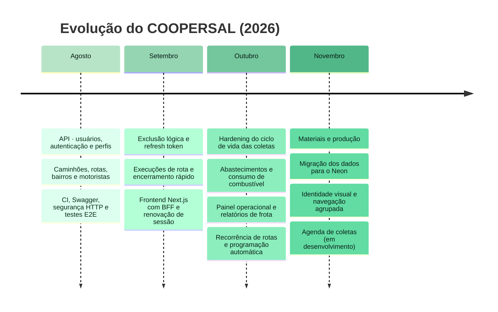

Além da aplicação principal, foi desenvolvida uma página pública de consulta (Next.js, estática, sem login) em que o morador busca o seu bairro e vê os dias e turnos da coleta.

---

## Acesso ao código

Este repositório contém a documentação pública do projeto. O código-fonte da aplicação é mantido em repositórios privados por questões de segurança e confidencialidade.

Detalhes adicionais de arquitetura e implementação podem ser apresentados em entrevista técnica.

---

## Autor

**Rômulo Zirbes**, desenvolvedor full stack

- GitHub: [@Rzirbes](https://github.com/Rzirbes)
- LinkedIn: [romulo-zirbes](https://www.linkedin.com/in/romulo-zirbes/)
- E-mail: [rzirbes5@gmail.com](mailto:rzirbes5@gmail.com)
